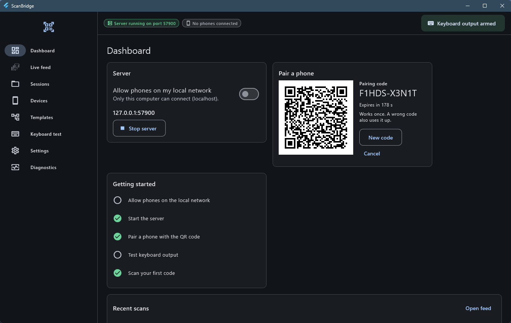
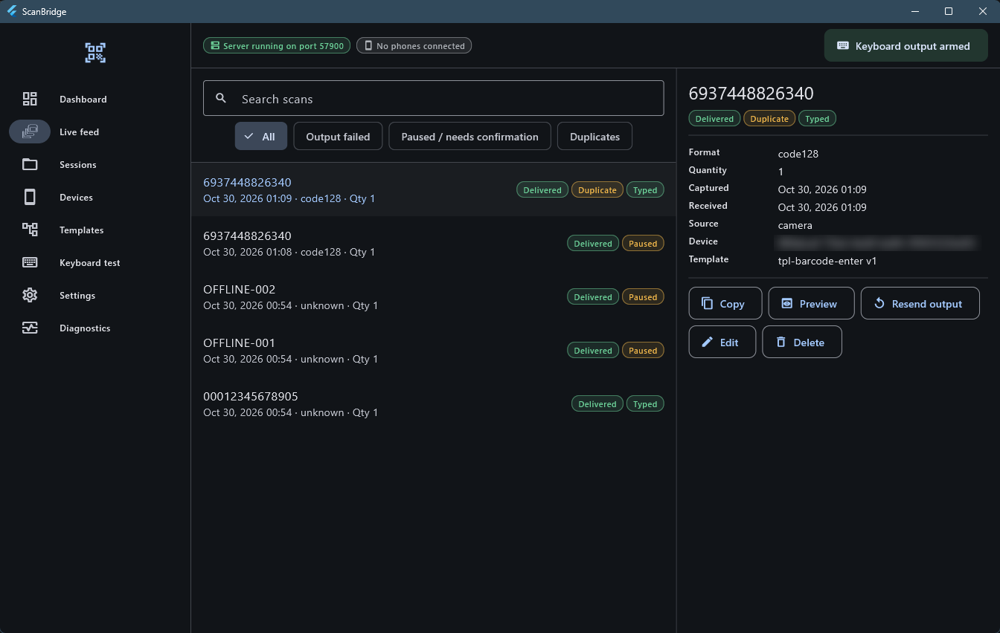
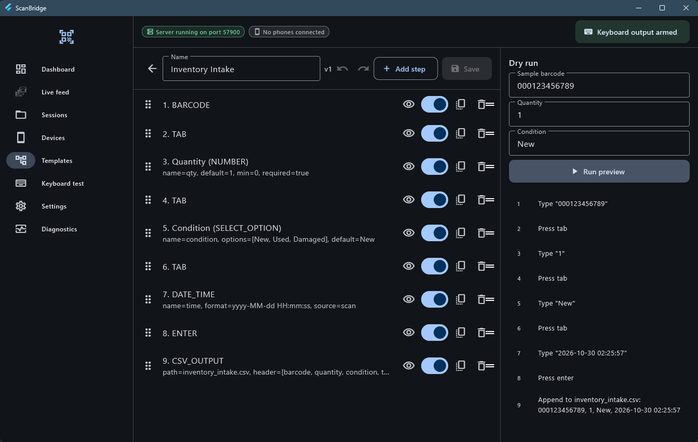
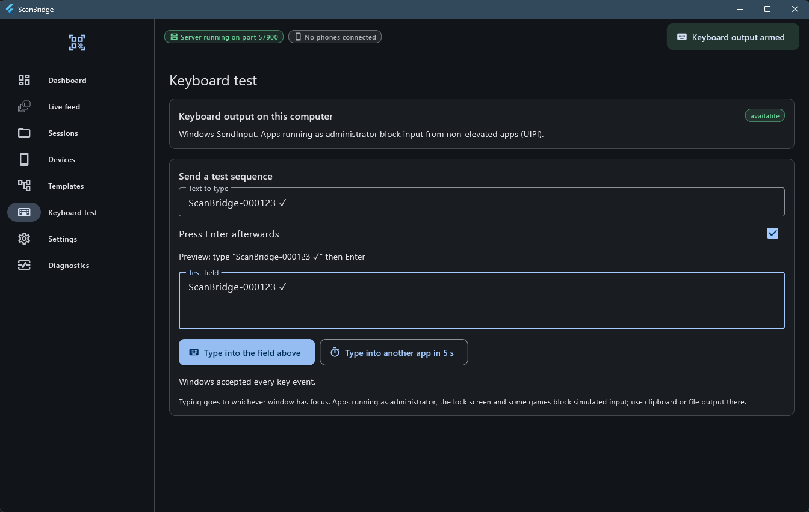
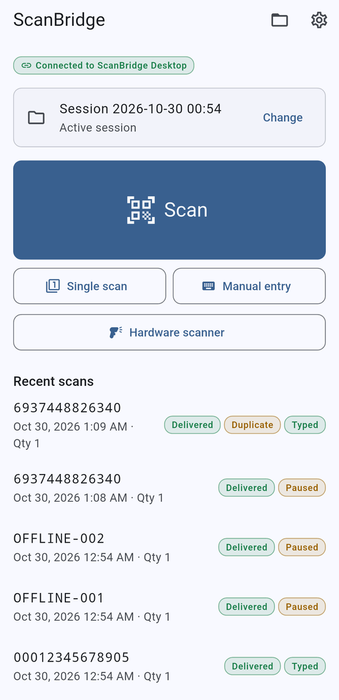
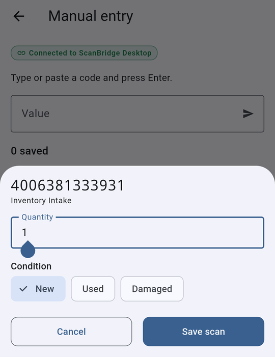
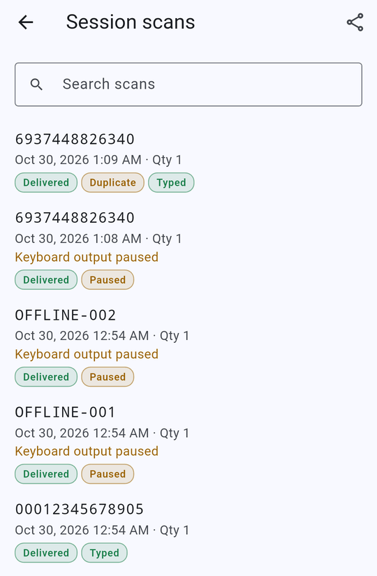

# ScanBridge

ScanBridge turns an Android phone or iPhone into a barcode/QR scanner for a Windows, macOS or Linux computer.

- Scans are **saved on the phone first**, then sent over your local network.
- The computer stores each scan and runs an output template. The template can type the code into the focused app, append it to CSV/text files, and more.
- No accounts, no cloud, no telemetry, and no limits on scans, devices or templates.

> This is an independent implementation inspired by the workflows of Barcode to PC. No code, assets or protocol were copied (see `docs/PROVENANCE.md`).

## Screenshots

**Desktop host (Windows)**

| Dashboard and one-time pairing QR | Live feed with delivery and output status |
|---|---|
|  |  |
| **Template builder with dry run** | **Keyboard output test** |
|  |  |

**Phone app (Android)**

<p>
  
  
  
</p>

*From left: home screen, template prompt (quantity and condition), and session scans showing what was delivered, typed or paused.*

## Download

The app is free for everyone under the MIT license. Get the latest build from **[Releases](https://github.com/rdr6000/ScanBridge/releases/latest)**:

- **Windows:** `ScanBridge-<version>-windows-x64.zip`. Unzip it and run `scanbridge_desktop.exe`.
- **Android:** `ScanBridge-<version>-android.apk`. Sideload it and allow "Install unknown apps".
- Check downloads against `SHA256SUMS.txt`.

## Status

| Platform | Role | State |
|---|---|---|
| Windows 10/11 x64 | Desktop host | ✅ Builds and runs. Keyboard typing verified |
| Android 7+ | Phone client | ✅ Runs on a device. Pairing, manual entry and offline sync verified |
| macOS / Linux | Desktop host | Code is shared, but these builds are untested. Keyboard adapters are not built yet (clipboard and file output work) |
| iOS / iPadOS | Phone client | Configured (camera and local-network strings) but not built here. Needs macOS + Xcode |

The full list is in [docs/FEATURE_MATRIX.md](docs/FEATURE_MATRIX.md), and the limits are in [docs/KNOWN_LIMITATIONS.md](docs/KNOWN_LIMITATIONS.md).

## Requirements

- Flutter 3.47+ / Dart 3.13+.
- **Windows host build:** Visual Studio 2022 (or Build Tools) with the *Desktop development with C++* workload **and the ATL component**. `flutter_secure_storage` needs ATL.
- **Android:** Android SDK 36, JDK 17.
- **iOS and macOS:** a Mac with Xcode. Device installs also need code signing.
- **Linux:** the Flutter desktop prerequisites plus `libsecret-1-dev` for secure storage.

## Build and run

```bash
flutter pub get                                   # from the repo root (pub workspace)
cd packages/scanbridge_storage && dart run build_runner build   # only after schema changes
cd apps/desktop && flutter run -d windows         # or: flutter build windows --release
cd apps/mobile  && flutter run -d <android-device-id>
```

The full pipeline (analyze → tests → builds) is in `scripts/build_all.ps1` (Windows) or `scripts/build_all.sh`. The scripts fail if an expected artifact is missing.

## First run (pairing)

1. On the desktop, turn on **Allow phones on my local network**, then click **Start server**.
2. When Windows Firewall asks, allow the app on Private networks.
3. Click **Show pairing QR**. The code is valid for 3 minutes and works once.
4. In the phone app, tap the connection chip, then **Scan pairing QR**. Or type the computer's IP, the port (default `57900`) and the code.
5. **Approve** the phone on the desktop.
6. Scan. The phone shows *Delivered*, and the desktop types the code into the focused window.

## Keyboard output

- Windows uses `SendInput` with Unicode events, so the keyboard layout does not matter. It supports Enter, Tab, arrow keys, F1–F12 and modifier combinations.
- **Arm/pause** with the top-right button (or Ctrl+Shift+P while the window is focused). Scans are still saved while paused.
- Key combinations such as Ctrl+… or Delete wait for confirmation in the Live feed. You can turn this off in Settings.
- Windows blocks typing into apps that run as administrator. ScanBridge detects this and reports it instead of claiming success. Use **clipboard fallback** or file output there.
- Check typing with **Keyboard test** before you rely on it.

## Templates

- A template is an ordered list of steps, for example `BARCODE → TAB → NUMBER(qty) → ENTER → CSV_OUTPUT`.
- Variables: `{{barcode}}`, `{{quantity}}`, `{{scan.timestamp}}`, `{{session.name}}`, `{{device.name}}` and any step's `name`.
- Each save creates a new version. The phone collects prompt answers (quantity, options, confirm), and the desktop runs that exact version.
- Built-in samples: *Barcode + Enter*, *POS Lookup*, *Inventory Intake* and *Stocktake*.
- Templates import and export as JSON. If an import has a bad field, the error names that field. Unknown steps are kept but disabled.

## Exports and files

- Sessions export to CSV, TSV, JSON or TXT. On the phone, exports go through the share sheet.
- CSV quoting keeps commas, quotes, newlines, Unicode and leading zeros intact. Values starting with `= + - @` are made spreadsheet-safe unless you turn that off.
- File steps (`CSV_OUTPUT`, `FILE_OUTPUT`, `CSV_LOOKUP`) can only use the **output folder** set in Settings. The default is `Documents/ScanBridge`.

## Network and firewall

- The default is localhost only. LAN mode listens on all IPv4 interfaces on TCP 57900.
- ScanBridge never changes firewall rules. Diagnostics shows instructions for Windows, macOS and Linux.
- The phone and the computer must be on the same network. Guest Wi-Fi often isolates devices from each other.

## Data, backup, delete

- **Desktop database:** `%APPDATA%\dev.scanbridge\scanbridge_desktop\scanbridge.db` on Windows. Settings → *Back up database* writes a consistent copy. To restore, close the app and replace the file.
- **Phone:** the app's private storage.
- Deleting a session removes its scans after you confirm. Single deletes can be undone. Nothing is purged automatically.
- Devices → *Forget all* revokes every phone.

## Privacy and security

- Scans never leave your devices unless you export them.
- Pairing uses a one-time code and your on-screen approval. After that, every message is HMAC-SHA256 signed with a per-device secret kept in OS secure storage.
- Traffic is **not encrypted** in v1, so use trusted networks. See [docs/SECURITY.md](docs/SECURITY.md) and [docs/PROTOCOL.md](docs/PROTOCOL.md).

## Troubleshooting

| Symptom | Fix |
|---|---|
| Phone can't connect | Same Wi-Fi? LAN mode on? Firewall allowed? Try the IP shown on the dashboard |
| "Pairing code expired or already used" | Click **New code**. A wrong code also uses up the current one |
| Scans stay "Queued" | The phone retries automatically. Open the app to trigger a reconnect, or tap the sync icon in the session |
| Output "failed" | See the error in the Live feed, fix the target, then **Resend output** |
| Typing goes nowhere | The target app may be elevated, or it is the lock screen. Use the clipboard fallback |
| Windows build error `atlstr.h` | Add the *C++ ATL* component in the Visual Studio Installer |

## Development

```text
apps/desktop   Flutter host (Windows/macOS/Linux)      apps/mobile  Flutter client (Android/iOS)
packages/      domain · protocol · template_engine · storage (Drift) · ui (theme + l10n)
docs/          architecture, protocol, security, feature matrix, test plan, audit
```

Tests: `dart test` in each pure package, and `flutter test` in `apps/desktop`. Details are in [docs/TEST_PLAN.md](docs/TEST_PLAN.md) and [docs/ARCHITECTURE.md](docs/ARCHITECTURE.md).

### Localization

- Strings live in `packages/scanbridge_ui/lib/l10n/app_en.arb` and `app_hi.arb` (English and Hindi).
- After editing an ARB file, run `flutter gen-l10n` in `packages/scanbridge_ui`.
- To add another language, add `app_<code>.arb` with the same keys. You need to translate other languages yourself or with a translation tool.

## License

The original code is MIT (see `LICENSE`). Dependency notices are in [docs/DEPENDENCY_LICENSES.md](docs/DEPENDENCY_LICENSES.md).
